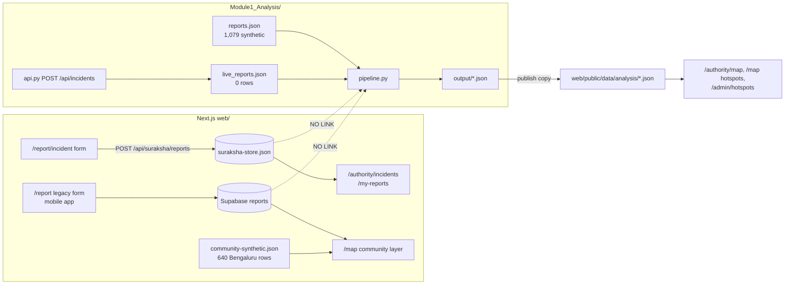

# SurakshaSetu: Project Audit and Implementation Roadmap

Project title: **Incident Analysis and Hotspot Identification for Security Provision against Women Harassment in Public Spaces**

- Audit date: 16 Oct 2026
- Repo: `/Users/anushak/Documents/3rd Semester`, branch `master`, HEAD `f13fa8f`
- Project folder: `Ongoing/`
- Scope: read-only inspection. No code, data, or store was changed while preparing this report.

Checks run during this audit:

| Check | Result |
|---|---|
| `web/scripts/suraksha-check.ts` (store and workflow assertions, temp store) | Passed: `suraksha-check ok` |
| `tsc --noEmit` on `web/` | **Failed**: `src/app/admin/dashboard/page.tsx` lines 90, 97, 107 use `pct` without importing it |
| `npm run build` prerequisites (`scripts/convert-dataset.ts`) | **Would fail**: needs `bengaluru_street_safety_REAL.xlsx` or `public/data/streets.json`. Neither exists |
| Store shape (counts only, no contents printed) | `web/data/suraksha-store.json`: 2 reports, 1 SOS, 3 tasks, 1 streetlight, 19 notices, 9 audit rows |
| Module 1 inputs | `input/reports.json`: 1,079 synthetic rows. `input/live_reports.json`: 0 rows |
| Last pipeline run | `output/pipeline_log.json`: 2026-09-15, under 1 second with the cached street index. 72 hotspots, 55 alerts, 0 live rows |

---

## 1. Executive summary

SurakshaSetu has three working parts that are not connected to each other:

1. **Operational app** (Next.js, `web/`). Citizens file incident reports, SOS alerts, and streetlight complaints. Authority, patrol, and municipal roles act on them. All of this is persisted in a JSON file store and works end to end. It is verified by `suraksha-check`.
2. **Analysis** (Python, `Module1_Analysis/`). Cleans reports, clusters them on a ~1 km grid, scores risk, and publishes JSON to `web/public/data/analysis/`. It works, but it reads only `input/reports.json` (1,079 synthetic rows) and `input/live_reports.json` (empty).
3. **Dashboards and maps**. These read static JSON files that were last generated on 2026-09-15.

**The incident-to-hotspot pipeline is not functional for new data.** An incident submitted through `/report/incident` is saved in `web/data/suraksha-store.json`. The analysis never reads that file. It does not rerun after a submission, and the hotspot map does not change. Every hotspot, alert, and risk count shown today comes from synthetic demo reports.

Other confirmed problems:

- The production build is broken (type error, plus a missing Bengaluru dataset step).
- Three separate incident stores exist: the Suraksha JSON store, the old Supabase `reports` table, and Module 1 `live_reports.json`.
- The old `/admin` portal and the user map still show Bengaluru-only prototype data on a statewide product.
- The deployment target matters: the JSON store and the Python step need a persistent server, so Vercel will not work as-is.

**Single most important next task:** connect the Suraksha store to the Module 1 pipeline and rerun the analysis after each create or review (Phase 2). The reasons are in section 10.

---

## 2. Current architecture and technology stack

| Layer | What is actually used | Evidence |
|---|---|---|
| Frontend | Next.js 16.2.9 App Router, React 19, TypeScript, Tailwind 4, Leaflet + react-leaflet, Recharts | `web/package.json` |
| Backend (operational) | Next.js route handlers under `/api/suraksha/*` | `web/src/app/api/suraksha/*/route.ts` |
| Operational store | One JSON file, `web/data/suraksha-store.json` (gitignored). Path can be overridden with `SURAKSHA_STORE` | `web/src/lib/suraksha/store.ts` `load()` / `save()` |
| Analysis | Python 3 standard library. `pipeline.py` (stages 6.1 to 6.8), `streetwise.py` (OSM street join), `import_infrastructure.py` (KSRSAC poles) | `Module1_Analysis/` |
| Analysis API | `api.py` on `127.0.0.1:8000`. Uses FastAPI if installed, otherwise `http.server` | `Module1_Analysis/api.py` |
| Analysis "database" | JSON files in `Module1_Analysis/database/`, shaped like Mongo collections | `pipeline.persist_database()` |
| Dataset | `Ongoing/Dataset/Karnataka/` (workbook, 30 district files, cameras, district GeoJSON). `Ongoing/Dataset/Karnataka_Streetwise/` (~954 MB CSV, gitignored) | `pipeline.DATASET` |
| Legacy (still in the app) | Supabase client and `reports` table, `/admin` portal (`ADMIN_PASSWORD` cookie), `/community`, `/report` | `web/src/lib/reports.ts`, `web/src/middleware.ts`, `supabase/migrations/` |
| Mobile | Expo app in `mobile/`. Writes to Supabase `reports`, not to the Suraksha store | `mobile/lib/reports.ts` |

Architecture today:



---

## 3. Implemented features and verification status

Legend:

- **Verified**: works, and was checked by a test or a request.
- **Partial**: some of it works, with a named gap.
- **Static**: the screen works but shows mock, static, or demo data.
- **Missing**: not built.
- **Unverified**: cannot be confirmed from this workspace.

| Area | Feature | Status | Evidence |
|---|---|---|---|
| Auth | Demo login with 6 roles, HMAC session cookie (12 h, HttpOnly) | Verified | `lib/suraksha/auth.ts`, `domain.ts` `DEMO_USERS`, `api/suraksha/session` |
| Auth | Page guards by role | Verified | `lib/suraksha/guard.ts` `requireRoles`, `authority/layout.tsx` |
| Auth | Real user accounts, password hashing, registration | Missing | Passwords are plaintext constants in `domain.ts` |
| Auth | Legacy `/admin` portal guard | Partial | `middleware.ts`. The cookie value is the static string `session:<ADMIN_PASSWORD>` |
| Incidents | Submit incident (category, now/past, description, optional GPS) | Verified | `ReportForms.tsx` → `POST /api/suraksha/reports` → `store.createReport` |
| Incidents | Server sets the time for "happening now" | Verified | `reports/route.ts` `occurred_at` |
| Incidents | List own reports and all reports by role | Verified | `store.listReports`, `/my-reports`, `/authority/incidents` |
| Incidents | Review states: submitted, under_review, verified, flagged | Verified | `store.reviewReport`, `PATCH /api/suraksha/reports` |
| Incidents | Edit or delete an incident | Missing | No handler |
| Incidents | Server-side validation of category, coordinates, and past date | Partial | Only "category present" is checked. Category is not matched against `INCIDENT_CATEGORIES`, and lat/lon types and past dates are not checked |
| Incidents | Duplicate-submission guard | Partial | In-memory limit of 20 per hour (`rateOk`). Resets on restart. No idempotency key |
| Location | District match from GPS | Partial | `domain.matchDistrict`: nearest district centroid by haversine, not a polygon test. `street_id` is always null |
| SOS | One-tap SOS, saved with optional location | Verified | `SosTap.tsx`, `POST /api/suraksha/sos`, `store.createSos` |
| SOS | Supervisor assigns a unit, patrol updates status | Verified | `store.assignSos`, `advanceSos`, `suraksha-check` |
| SOS | Real 112 or control-room dispatch, SMS or push | Missing | Every notice is labelled `simulated_not_sent_to_a_phone` |
| Patrol | Tasks, reassign, availability | Verified (demo unit) | `store.createTask`, `advanceTask`, `reassignTask`. One unit, `simulated: true`, no GPS |
| Streetlights | Complaint, police review, municipal repair, one-tap "report to police", police close | Verified | `store.createLight`, `advanceLight`, `reportLightToPolice`, `suraksha-check` |
| Notifications | In-app inbox and audit log | Verified | `store.notify`, `audit`, `GET /api/suraksha/inbox` |
| Analysis | Ingest, preprocess (bbox, duplicates, missing values) | Verified on synthetic data | `pipeline.ingest`, `preprocess`, `pipeline_log.json` |
| Analysis | Classification (type, time of day) | Partial | `classify()`. Time of day comes from `created_at`, not from when the incident happened |
| Analysis | Hotspots: 0.01° grid, at least 3 reports, risk levels, recurrence | Verified on synthetic data | `cluster_hotspots`, `risk_level`, `_self_check` |
| Analysis | Alerts and patrol hints | Verified on synthetic data | `make_alerts` |
| Analysis | Uses real submitted incidents | **Missing** | `ingest()` reads only `reports.json` and `live_reports.json`. The Suraksha store is never read |
| Analysis | Automatic rerun on a new incident | Partial | Only `api.py POST /api/incidents` reruns, and nothing in `web/` calls it |
| Analysis | Time-trend series (daily or weekly counts) | Missing | No trend output. `first_seen` and `last_seen` exist per hotspot only |
| Streets | 604,573 scored OSM streets, nearest-street join for hotspots | Verified (offline) | `streetwise.py`, `output/street_stats.json`, `street_matches.json` |
| Infrastructure | Coverage page (lamps within 300 m, CCTV within 500 m, by district) | Verified (static snapshot) | `authority/coverage/page.tsx`, `infrastructure_coverage.json` |
| Infrastructure | KSRSAC street-light pole import | Partial | About 150,000 of 1,074,618 rows, mostly Bengaluru. Stopped because the disk was full |
| Infrastructure | Official statewide CCTV register | Missing (not publicly available) | `infrastructure_coverage.json` sources section |
| Maps | Hotspot cells on the authority and user maps | Static | Read once from `/data/analysis/hotspots.json` (2026-09-15) |
| Maps | User-map community layer | Static | Default source is `community-synthetic.json`: 640 Bengaluru rows (`StreetMapView` `communitySource="generated"`) |
| Maps | User-map street layer | Missing | `/data/streets.json` and `streets.min.json` return 404. The loader returns `[]` |
| Dashboards | Authority overview counts (SOS, reports waiting, lights) | Verified (live store) | `store.overview()` |
| Dashboards | Legacy `/admin/dashboard` KPIs | Static (Bengaluru) | Reads `public/data/summary.json` and `areas.json` (53 BBMP areas). Also has a type error |
| Dashboards | Legacy `/community`, `/admin/analytics` | Static (Bengaluru) | `CommunityDashboard.tsx` |
| Legacy | Supabase report form and mobile app | Unverified | `lib/reports.ts`. The Supabase project state cannot be checked from here |
| Deploy | Production build | **Broken** | tsc error. `convert-dataset.ts` exits 1 |
| Tests | Store and workflow assertions | Verified | `scripts/suraksha-check.ts` |
| Tests | Pipeline self-check | Verified (inline) | `pipeline._self_check` |
| Tests | API, end-to-end, or UI tests | Missing | |

---

## 4. Project objectives and requirements

### 4.1 Existing requirements

Sources: root and Module 1 READMEs, synopsis mapping in `pipeline.py`, `domain.ts`, and decisions already agreed in this project.

**Primary objectives**

- O1. Analyse past harassment incidents across **Karnataka (30 districts)** and identify hotspots. This is historical concentration, not prediction.
- O2. Assess risk levels (Low, Medium, High) for hotspots and areas.
- O3. Give citizens one-tap SOS and a way to report incidents and streetlight faults.
- O4. Give authorities one dashboard for incidents, SOS, patrol tasks, hotspots, and streetlight follow-up.
- O5. The mobile app and the authority dashboard are **one module** (Module 2, Aman). Analysis is Module 1 (Anusha).

**Functional requirements**

- FR1. Register an incident: category, now or past, time, optional description, optional GPS.
- FR2. Authority review workflow for incidents.
- FR3. SOS: one tap, location if available, still saved without location.
- FR4. Patrol assignment and task status updates.
- FR5. Streetlight complaint lifecycle. Municipal hands back to police in one tap. Police close.
- FR6. Role-based workspaces: citizen, supervisor, reviewer, patrol, municipal, admin.
- FR7. Analysis APIs: statistics, hotspots, risk-levels, geography, incidents, alerts (`api.py`).
- FR8. Automatic analysis update after a new incident (synopsis 6.7, Module 1 README).

**Data and analytics requirements**

- DA1. Stages 6.1 to 6.8: integration, preprocessing, incident analysis, geospatial analysis, hotspots, risk, automatic update, result delivery.
- DA2. KSP crime tables stay district totals. They are never used as map points (`crime_used_as_coordinates = false`).
- DA3. OSM street scores are an infrastructure proxy, not a crime rate.
- DA4. No invented counts, roads, coordinates, CCTV, patrol GPS, or repair outcomes.

**Geographic and mapping requirements**

- GM1. Statewide coverage. The Karnataka bounding box (11.5–18.6 N, 74.0–78.6 E) is enforced in preprocessing.
- GM2. Hotspot cells on a map with filters for area, type, date, time, and risk (`AuthorityFilterBar`).
- GM3. Infrastructure coverage by district, computed from real records only.

**Security and privacy requirements**

- SP1. Reporting stays anonymous to the public. `comment` and `reporter_id` are not exposed.
- SP2. Role checks on every authority action.
- SP3. Never claim that a police unit or municipal system was contacted unless delivery is confirmed.
- SP4. No secrets, `.env`, or live store in git.

**Performance, reliability, and usability requirements**

- PR1. SOS is one tap with no confirmation screen. Geolocation timeout is 2.5 s.
- PR2. The app must run on the development laptop with little free disk (the Turbopack cache is disabled).

### 4.2 Additional recommendations (not yet agreed)

- R1. Define exactly which incident statuses count toward hotspots (see question Q1 in section 12).
- R2. The dashboard should reflect a new or reviewed incident within 60 seconds without a manual refresh.
- R3. Atomic store writes, so a crash mid-write cannot corrupt the store.
- R4. Show a visible "Demo data" or "Live data" badge wherever analysis numbers appear.

---

## 5. End-to-end incident pipeline audit

Expected flow:

```
Submit → Validate → Store → Retrieve → Preprocess → Analyse → Hotspots/metrics → Dashboard/map
```

Actual flow:

```
/report/incident ──POST──► /api/suraksha/reports ──► store.createReport ──► suraksha-store.json
                               (category present only)                         │
                                                                               ├──► /authority/incidents  (on page load)
                                                                               ├──► /my-reports           (on page load)
                                                                               └──X  pipeline.py never reads it

pipeline.py ◄── input/reports.json (1,079 synthetic) + input/live_reports.json (0 rows)
     └──► output/*.json ──copy──► web/public/data/analysis/*.json ──fetch once──► maps / hotspot boards
     (runs only when started by hand, or by api.py POST /api/incidents, which nothing calls)
```

| # | Check | Result | Evidence |
|---|---|---|---|
| 1 | New incident is persisted | **Yes** | `createReport` calls `save(db)`. The store holds 2 reports |
| 2 | Required fields stored | **Mostly** | `id`, `category`, `when`, `occurred_at`, `status`, `created_at`, and `location{latitude, longitude, district, match_status}` are stored. Coordinates are optional and allowed to be null. `street_id` is always null |
| 3 | Backend reads from the store, not samples | **Operational screens: yes. Analysis: no** | `listReports` reads the store. `pipeline.ingest()` reads `REPORTS` and `LIVE_REPORTS` only |
| 4 | Analysis uses the latest records | **No** | Last run 2026-09-15. `summary.stats.live = 0` |
| 5 | New incidents update hotspots | **No** | Nothing calls the pipeline from `web/` |
| 6 | Dashboard updates without restart or manual edits | **No** | `loadAnalysisHotspots()` fetches a static file once on mount. No polling, revalidation, or push |
| 7 | Duplicates, invalid data, missing coordinates, store errors | **Partial** | See the list below this table |
| 8 | Edits and deletions trigger recalculation | **No** | No edit or delete exists. Review changes do not trigger analysis |
| 9 | Historical incidents kept for trends | **Partial** | The store keeps all rows (`unshift`, never pruned). No trend output exists |
| 10 | Correct after restart or deployment | **Partial** | Survives a restart on the same machine. The rate limit resets. On serverless hosting (Vercel), the file store is not persistent and Python cannot run |

Detail for check 7:

- Duplicates: only the in-memory 20-per-hour limit. Preprocessing drops duplicate IDs, but it never sees store rows.
- Invalid data: lat/lon are not type-checked on the server. Category is free text. A past `occurred_at` is not checked for format or future dates.
- Missing coordinates: saved as `match_status: "missing"`. Correct for the record, but the pipeline would drop these rows when they are later fed in, and this is not reported to the user.
- Store errors: `load()` calls `JSON.parse` without a guard, so a corrupted file breaks every `/api/suraksha/*` route. `save()` writes the file in place, so a crash mid-write can truncate it.

**Mapping gaps to close when connecting the store to the pipeline** (fields the pipeline expects):

| Pipeline expects | Store has | Action |
|---|---|---|
| Top-level `lat`, `lon` | `location.latitude`, `location.longitude` | Map the fields in ingest |
| `status == "approved"` | `submitted`, `under_review`, `verified`, `flagged` | Decide which statuses count (Q1) |
| `incident_type` in `INCIDENT_TYPES` (for example `stalking`, `eve_teasing`, `verbal_abuse`) | Free-text labels from `INCIDENT_CATEGORIES` | Add a fixed label-to-type map |
| `created_at` used for time of day and recurrence | `occurred_at` is the event time | Use `occurred_at` |
| `district` | `location.district` | Map the field |

---

## 6. Database persistence and automatic dashboard refresh audit

### 6.1 Persistence

- **Source of truth for operational data:** `web/data/suraksha-store.json`. One process does a synchronous read, modify, and write, so updates do not interleave inside one Node process.
- **Ceilings:**
  - No locking across processes, so two servers or a parallel script would lose updates.
  - The whole file is rewritten on every action.
  - No indexes. Every list is a linear filter.
  - Acceptable up to a few thousand rows for this project. Mark it with a `ponytail:` note. Move to SQLite only if real volume appears.
- **Analysis store:** `Module1_Analysis/database/*.json` is a copy of `output/` and is written by the pipeline only. It is not a source of truth.
- **Supabase `reports`:** used by the legacy `/report` form, the mobile app, and the `/map` "real" layer. Configured in `.env.local` (key names only were checked). Never read by the pipeline. The remote state is unverified.

### 6.2 Dashboard refresh mechanisms present today

| Screen | Data source | Refresh |
|---|---|---|
| `/authority` overview | `GET /api/suraksha/inbox` | Page load only |
| `/authority/incidents`, `/authority/lights`, `/authority/alerts`, `/patrol`, `/municipal` | `/api/suraksha/*` | Page load, and refetch after the user's own action (`.then(load)`) |
| `/my-reports` | `/api/suraksha/*` | Page load only |
| `/authority/map` (`HotspotBoard`), `/map`, `/admin/hotspots` | `/data/analysis/*.json` (static) | Fetched once. The content changes only when someone reruns the pipeline by hand |
| `/authority/coverage` | `infrastructure_coverage.json` read on the server | Page load |
| `/admin/dashboard` | `public/data/summary.json` (Bengaluru) | Page load |

There is no polling, server-sent events, WebSocket, or `router.refresh()` after a submission.

### 6.3 Recommended mechanism (simplest that is reliable)

1. **After a successful create or review:** the Next route handler starts the pipeline as a child process (`python3 Module1_Analysis/pipeline.py`). Only one run at a time; if another request arrives during a run, do one more run when it finishes. A run takes under 1 second with the cached street index. The incident response is returned without waiting for the run.
2. **Serve analysis through a route,** `GET /api/suraksha/analysis/<name>`, that reads `Module1_Analysis/output` with `Cache-Control: no-store`. This replaces fetching `/data/analysis/*.json`. Next.js only guarantees serving files that were in `public/` at build time, so publishing into `public/` after deployment is unreliable (suspected; needs a `next start` test).
3. **Authority screens poll every 30 seconds** while the tab is visible. Also refetch right after the user's own action. No WebSockets or server-sent events are needed for this project.

Expected behaviour to agree on: a new incident (or one that has been verified, depending on Q1) appears in the hotspot data within about 30 seconds on any open authority screen, with no restart.

---

## 7. Confirmed issues and risks

### 7.1 Confirmed

| ID | Issue | Impact | Evidence |
|---|---|---|---|
| C1 | Suraksha store is not connected to the analysis | New incidents never affect hotspots, alerts, or risk | `pipeline.ingest()` |
| C2 | Hotspot and alert numbers are 100% synthetic | Dashboards look live but are a demo | `summary.stats.synthetic = 1079`, `live = 0` |
| C3 | Production build fails | Cannot deploy | `tsc` errors in `admin/dashboard/page.tsx`. `convert-dataset.ts` exits 1 without the Bengaluru xlsx or `streets.json` |
| C4 | Three incident stores | Inconsistent counts. Mobile reports go to Supabase only | `store.ts`, `lib/reports.ts`, `api.py ingest_incident` |
| C5 | Bengaluru prototype data shown in a statewide app | Misleading | `/map` defaults to 640 Bengaluru synthetic points. `/admin/dashboard` shows 53 BBMP areas. `Charts.tsx` says "53 BBMP zones ranked" |
| C6 | `api.py POST /api/incidents` and `/api/analysis/refresh` have no auth and allow CORS `*` | Anyone who can reach port 8000 can inject reports and trigger runs | `api.py`. It binds to `127.0.0.1`, which limits exposure |
| C7 | Weak server-side validation | Bad categories, coordinates, or dates can be stored | `reports/route.ts` |
| C8 | Store file is not crash-safe | One bad write breaks every API | `store.load` and `save` |
| C9 | Demo credentials are hard-coded, with a fallback HMAC secret `suraksha-local-demo` | Anyone can forge sessions if `SURAKSHA_SECRET` is not set | `auth.ts`, `domain.ts` |
| C10 | Event time ignored in analysis | Time of day and recurrence use submission time | `_time_of_day`, `cluster_hotspots` |
| C11 | Area risk mixes in the OSM infrastructure risk | An area can be "High" from street infrastructure alone, which goes against DA3 | `area_stats`: `osm_risk_level == "High"` |
| C12 | District comes from the nearest centroid, not the boundary | Border points can get the wrong district | `matchDistrict`. `karnataka_districts.geojson` exists but is not used here |
| C13 | Street-light import is partial and Bengaluru-first | The coverage page understates other districts | `infrastructure_coverage.json` |
| C14 | `/map` street layer is empty | Filters for score, CCTV, and bus do nothing | 404 on `streets.json` |

### 7.2 Suspected (needs a test)

| ID | Suspicion | How to test |
|---|---|---|
| S1 | Files rewritten in `public/` after `next build` may not be served fresh by `next start` | Build, rerun the pipeline, then fetch `/data/analysis/summary.json` |
| S2 | Rerunning the pipeline while it is serving can corrupt a reader mid-write (no tmp-and-rename in `_write`) | Run the pipeline in a loop while polling the API |
| S3 | The legacy `/admin` cookie never rotates (static value derived from the password) | Inspect the `api/admin/login` cookie attributes |
| S4 | Municipal accounts can see the authority `overview()` counts and the unit list | `GET /api/suraksha/inbox` and `/tasks` as municipal |
| S5 | `web/CLAUDE.md` hangs on read (iCloud), so tools other than Tailwind may stall | Exclude it or move it out of `web/` |

---

## 8. Missing and recommended features

Only features tied to the objectives and to confirmed gaps are listed.

1. Store-to-pipeline connection and automatic rerun. Covers C1, C2, C10, and FR8.
2. Analysis served through a route, plus a refresh policy (polling).
3. Server-side validation, an idempotency key, and crash-safe writes. Covers C7 and C8.
4. A working production build. Covers C3.
5. One incident source of truth: retire or bridge the Supabase path. Covers C4.
6. Remove Bengaluru-only defaults, or label them clearly. Covers C5 and C14.
7. Point-in-polygon district assignment using `karnataka_districts.geojson`. Covers C12.
8. Time-trend output (daily and weekly counts per district) and a chart.
9. "Demo" or "Live" data badges driven by `summary.stats`.
10. Secure configuration: require `SURAKSHA_SECRET` in production and protect the `api.py` write routes. Covers C6 and C9.
11. Finish the street-light import when disk allows. Covers C13.

---

## 9. Prioritized implementation backlog

Effort uses one developer: **S** is half a day or less, **M** is 1 to 2 days, **L** is 3 or more days.

| # | Feature | Purpose and user benefit | Dependencies | Frontend | Backend | Data | Priority | Effort |
|---|---|---|---|---|---|---|---|---|
| B1 | Connect the store to the pipeline | Real incidents drive hotspots. Authorities see actual concentrations | Q1 decision | None | `pipeline.ingest()` reads the store reports: map fields, use `occurred_at`, map category to type | Read-only on the store | **Critical** | M |
| B2 | Rerun after create or review | Analysis stays current without anyone running scripts | B1 | None | Route handlers start the pipeline (one at a time, one queued run) | `_write` uses tmp file and rename | **Critical** | S |
| B3 | Analysis API route and 30 s polling | Open dashboards update on their own | B2 | Replace static fetches in `analysis.ts`, `HotspotBoard`, `StreetMapView`. Poll while visible | `GET /api/suraksha/analysis/[name]` reading `output/`, `no-store` | None | **Critical** | S |
| B4 | Fix the build | Deployable app | None | Import `pct` in `admin/dashboard` | Make `build:data` skip when the Bengaluru xlsx is absent | None | **Critical** | S |
| B5 | Validation and crash-safe store | No bad rows. No store corruption | None | Show server errors | Check category against the list, lat/lon numbers, past dates in range. Guard `JSON.parse`. Atomic save | None | **High** | S |
| B6 | Idempotent submission | No double reports from a double tap or retry | B5 | Send a `client_id` with each submission | Ignore a repeated `client_id` from the same owner | Store `client_id` | High | S |
| B7 | Live-vs-demo labelling, hide Bengaluru defaults | Honest dashboards | B1 | `/map` community layer defaults to live store points. Hide or redirect `/admin/*` and `/community`. Add data badges | None | None | High | S |
| B8 | Single incident source | Consistent counts | Q2 decision | Legacy `/report` redirects to `/report/incident` | Remove Supabase reads from the map, or bridge them into the store | None | High | M |
| B9 | Polygon district match | Correct district at borders | None | None | Use `karnataka_districts.geojson` in `matchDistrict` (ray casting, standard library) | None | Medium | S |
| B10 | Time trends | Trend analysis is a stated analytics goal | B1 | Line chart on `/authority` | Pipeline writes `trends.json` (by day, week, district) | None | Medium | S |
| B11 | Production security configuration | Sessions cannot be forged. Analysis write routes are protected | None | None | Fail start-up in production without `SURAKSHA_SECRET`. Shared token on `api.py` POST routes, or drop them in favour of B2 | None | Medium | S |
| B12 | Area risk from incidents only | Follows DA3 | B1 | Show the OSM proxy as a separate column | Remove `osm_risk_level` from `area_stats` risk | None | Medium | S |
| B13 | Incident edit and withdraw (owner, before review) | Data quality | B2 | Button on `/my-reports` | `PATCH` by owner while `submitted`. Set status `withdrawn` instead of deleting | New status value | Low | S |
| B14 | Finish the KSRSAC pole import | Statewide lamp coverage | About 1 GB free disk | None | Resume `import_infrastructure.py poles` | Gitignored CSV | Low | M (mostly waiting) |

Not recommended now (they do not serve a stated objective): Kafka or queues, WebSockets, a second database, ML prediction, native push, or real 112 integration (the last needs official access).

---

## 10. Phased next-step roadmap

The order is adapted from your list. The build fix (B4) is done inside Phase 2 because it is small and unblocks Phase 7.

### Phase 1: Audit and baseline (this document)

- Deliverables: this file, the feature table, and the confirmed issues.
- Acceptance: you agree on Q1 to Q4 in section 12.
- Verification: decisions are recorded in this file.

### Phase 2: Core data pipeline (B1, B2, B4, B5)

- Deliverables:
  - `pipeline.ingest()` reads the Suraksha store with field mapping.
  - The route handlers start the pipeline after a create or review.
  - Atomic writes on both sides.
  - Server-side validation.
  - The build passes.
- Dependencies: Q1.
- Acceptance:
  - Submit an incident at a fixed test location 3 times (status per Q1). `output/hotspots.json` gains or updates that cell, and `summary.stats.live` increases. No manual step.
  - Invalid category, coordinates, or date returns 400 and nothing is stored.
  - `npm run build` succeeds.
- Verification:
  - Extend `scripts/suraksha-check.ts`: temp store, 3 reports, run the pipeline against the temp store, assert the hotspot exists.
  - `tsc --noEmit` is clean.

### Phase 3: Analytics accuracy (B9, B10, B12, plus the C10 fix)

- Deliverables:
  - Event time drives time of day and recurrence.
  - Polygon district match.
  - Area risk based on incidents only.
  - `trends.json`.
- Acceptance:
  - Incident count in the summary equals the sum over districts and equals the number of map markers for the same filter.
  - A known border point is assigned to the correct district.
- Verification: assertions added to `pipeline._self_check` and `suraksha-check`.

### Phase 4: Automatic dashboard updates (B3, B7)

- Deliverables:
  - Analysis API route.
  - 30-second polling on authority screens.
  - Refetch after the user's own action.
  - Live and demo badges.
  - `/map` defaults to live data.
- Acceptance: with `/authority/map` open in one tab, an incident submitted in another tab appears within 30 seconds without a reload.
- Verification: manual two-tab test, plus `curl` of the route before and after a submission.

### Phase 5: Remaining essential features (B6, B8, B11, B13)

- Deliverables: idempotency, a single incident source, production security configuration, owner withdraw.
- Acceptance:
  - A double tap creates one record.
  - The mobile path either reaches the store or is clearly marked as legacy.
  - The app refuses to start in production without a secret.
- Verification: new assertions in `suraksha-check`.

### Phase 6: Testing and validation

- Deliverables: the checklist in section 11, run and recorded.
- Acceptance: all items pass on a fresh clone with an empty store.
- Verification: `suraksha-check`, `pipeline.py` self-check, `tsc`, `next build`, and the manual two-tab test.

### Phase 7: Deployment readiness

- Deliverables:
  - Deployment target chosen (Q3).
  - `.env.example` updated with `SURAKSHA_SECRET` and `SURAKSHA_STORE`.
  - Store on a persistent disk.
  - `python3` available on the host.
  - Logs from pipeline runs.
- Acceptance: restart the server and data is still there. A submission after the restart still updates the hotspots.
- Verification: restart test on the target host.

### Why the first task is Phase 2, item B1 (connect the store to the pipeline)

It is the project's central claim: incidents become hotspots. Today that link does not exist, so every analysis number on screen is synthetic.

Everything else depends on it:

- Auto-refresh is useless without fresh analysis.
- Trends need real rows.
- Live and demo labels need a live source.

It is also cheap. The pipeline runs in under 1 second, and the store is already the source of truth, so it needs a field mapping in `ingest()` and a trigger. No new service or database is required.

---

## 11. Testing and acceptance checklist

- [ ] `tsx scripts/suraksha-check.ts` passes, with new pipeline assertions.
- [ ] `python3 Module1_Analysis/pipeline.py` prints `SELF-CHECK OK`, with live rows greater than 0 when the store has qualifying reports.
- [ ] `tsc --noEmit` is clean. `npm run build` succeeds without the Bengaluru xlsx.
- [ ] Submit an incident: the row is in the store with category, `occurred_at`, status, and location (`match_status` set).
- [ ] Submit 3 qualifying incidents in one cell: the hotspot appears in `/api/suraksha/analysis/hotspots` within 30 seconds.
- [ ] Review (verify or flag) changes the hotspot inclusion according to Q1.
- [ ] Invalid category, coordinates, or future past-date returns 400, and the store is unchanged.
- [ ] Missing coordinates: saved, shown as "location missing", and excluded from hotspots, with the count shown in the summary.
- [ ] Double submit with the same `client_id` creates one row.
- [ ] Corrupt store file: the API returns a clear 500 and the file is not overwritten blank.
- [ ] Role checks: patrol cannot open `/authority/*`, municipal cannot review incidents, public sees only their own rows.
- [ ] Restart the server: the store survives and the analysis still updates.
- [ ] Counts are consistent: summary incidents = sum by district = markers for the same filter.
- [ ] No Bengaluru-only dataset is shown by default on statewide screens.
- [ ] No secrets, `.env`, or `suraksha-store.json` in `git status`.

---

## 12. Questions or external access needed

| ID | Question | Why it matters |
|---|---|---|
| Q1 | Which incident statuses should count toward hotspots? Recommended: `submitted` and `verified` count, `flagged` is excluded. The stricter option is `verified` only | Decides when a new incident moves the map, and how resistant the map is to fake reports |
| Q2 | Should the Supabase `reports` path (legacy `/report` form and Expo `mobile/`) be retired, or bridged into the Suraksha store? | Removes the three-store split (C4). Affects Aman's mobile work |
| Q3 | Where will this be deployed: your laptop for the demo, a college VM, or Vercel? | The JSON store and the Python pipeline need a persistent disk and `python3`. Vercel cannot provide either without a redesign |
| Q4 | Keep the 1,079 synthetic reports as a labelled baseline next to live data, or drop them once live rows exist? | Affects whether the demo map shows hotspots before real data accumulates |
| Q5 | Is there official access to a KSP CCTV register, BBMP/ESCOM streetlight data, or 112 integration? | Without it these stay missing or simulated, as they are now |
| Q6 | Free about 1 GB of disk if you want the street-light pole import resumed | The current partial import is Bengaluru-heavy |
